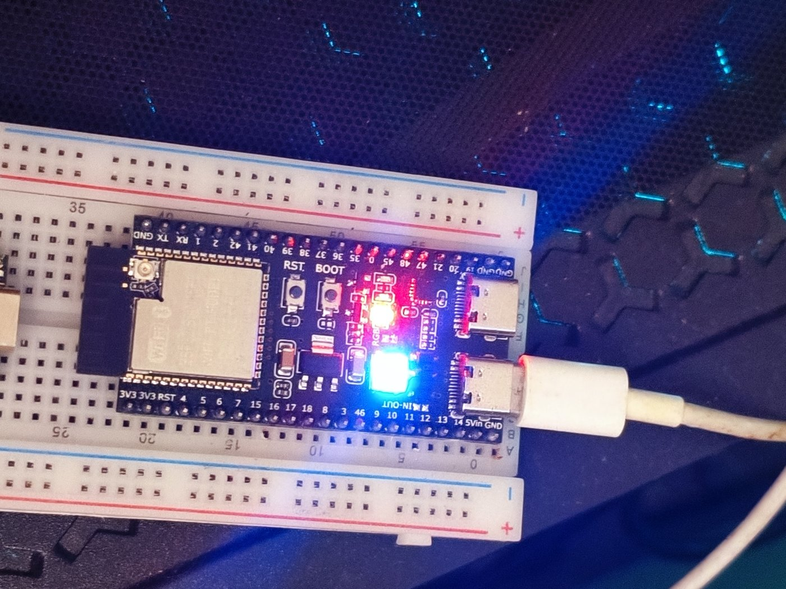
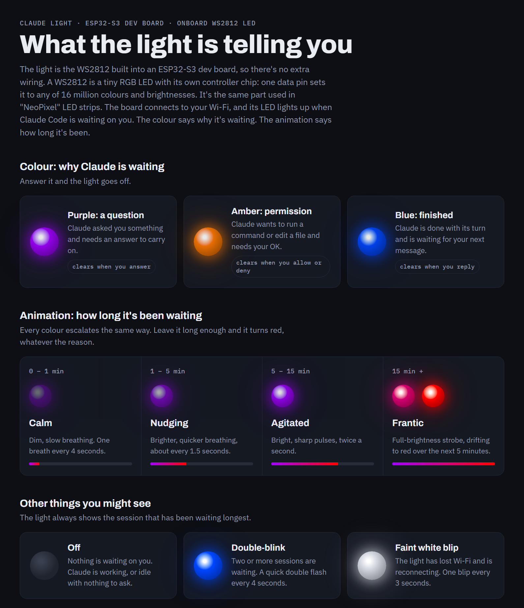

# Claude Light

An ESP32-S3 dev board whose onboard WS2812 RGB LED lights up when Claude Code
is waiting on you. No extra hardware or wiring: the LED is already on the board.



*The board in use. The bright blue LED next to the "RGB" label is the WS2812,
showing blue for "Claude has finished and is waiting for you". The small red
LED above it is the board's power light.*

## Why

Claude Code often works for minutes at a time, so it's natural to switch to
something else while it runs. The catch is that it regularly stops and waits
for you: to answer a question, to approve a command, or because it has
finished. Unless you keep checking the terminal, that waiting time is lost,
and with several sessions open it's easy to forget one entirely.

Claude Light moves that signal off the screen and onto the dev board's
built-in LED. One glance tells you whether Claude is waiting, why, and roughly for how long. The longer
it's ignored, the more "agitated" it looks, so a session that's been stuck for
twenty minutes is hard to miss. When nothing needs you, it stays dark.

It's also a small, complete example of wiring Claude Code
[hooks](https://code.claude.com/docs/en/hooks) to physical hardware.

## LED states



*The source is [`docs/infographic.html`](docs/infographic.html), an animated
version you can open in a browser. Download it and open it locally to see each
state move.*

### Colour: why Claude is waiting

| LED | Meaning | Goes off when |
|---|---|---|
| 🟣 **Purple** | Claude asked you a question | you answer |
| 🟠 **Amber** | Claude needs permission to run a command or edit a file | you allow or deny |
| 🔵 **Blue** | Claude finished its turn and is waiting for your next message | you reply |

### Animation: how long it's been waiting

Every colour escalates the same way.

| Waiting | Stage | What the LED does |
|---|---|---|
| 0 – 1 min | 😌 Calm | dim, slow breathing (one breath every 4 s) |
| 1 – 5 min | 🙂 Nudging | brighter, quicker breathing (every 1.5 s) |
| 5 – 15 min | 😠 Agitated | bright, sharp pulses, twice a second |
| 15 min + | 😡 Frantic | full-brightness strobe, colour drifting to 🔴 red over 5 min |

### Other states

| LED | Meaning |
|---|---|
| ⚫ **Off** | nothing is waiting on you |
| ✨ **Double-blink every 4 s** | two or more sessions are waiting; the LED shows the one waiting longest |
| ⚪ **Faint white blip every 3 s** | the board has lost Wi-Fi and is reconnecting |

Design: `docs/superpowers/specs/2026-11-03-claude-light-design.md`.
Shareable guide to the light: `docs/infographic.html`.

## How it works

```
Claude Code hook ──HTTP POST──▶ claude-light.local (ESP32 on Wi-Fi) ──▶ LED
```

Claude Code runs `hooks/claude_light_hook.py` when it asks a question, needs
permission, finishes, or when you respond. The hook sends a tiny JSON event to
the board over your home Wi-Fi and returns immediately, so Claude Code is never
slowed down. The board, running MicroPython, keeps a table of waiting sessions
and animates the LED for the one that has waited longest. It advertises itself
by mDNS as `claude-light.local`, so you don't need its IP address.

## The board

Any ESP32-S3 board with a WS2812 ("NeoPixel") RGB LED should work. This was
built on a common, inexpensive **ESP32-S3-DevKitC-1 clone, N16R8 variant**:

| | |
|---|---|
| Chip | ESP32-S3, dual-core 240 MHz, Wi-Fi 2.4 GHz + Bluetooth 5 LE |
| Memory | 16 MB flash, 8 MB octal PSRAM ("N16R8") |
| LED | onboard WS2812 RGB on **GPIO48** |
| USB | two USB-C ports: native USB (use this one) and a CH343 USB-UART |

Things worth knowing about this board:

- **Use the native USB port** (it appears as "USB Serial Device", Espressif
  VID 303A) for flashing and the MicroPython REPL.
- **Flash the `SPIRAM_OCT` MicroPython build.** The 8 MB PSRAM is octal;
  the plain build won't use it.
- **GPIO35, 36 and 37 are wired to the PSRAM.** Don't use them for anything else.
- **Power:** once Wi-Fi is on, the chip draws short current spikes of
  300–500 mA. Some PC USB ports (especially front-panel ports, hubs or long
  thin cables) sag enough to trip the brownout detector and reset it in a
  loop. A phone charger or a rear motherboard port with a short cable fixes it.
- Ours shipped with a manufacturer's self-test sketch ("HW-678" mass-production
  test) that runs a Wi-Fi hotspot and a test web page. Flashing MicroPython
  replaces it.

## Setup

### The easy way: ask Claude Code

You don't have to run the steps below yourself. Clone this repo, open Claude
Code in it, plug the board into your computer by its native USB port, and ask:

> Set up Claude Light on my ESP32-S3 board.

`CLAUDE.md` gives Claude the board details it needs. It will find the board's
port, download and flash MicroPython, upload the code, check the board answers
on your network, and install the hooks in your Claude Code settings. It shows
you the settings change before saving it.

What you do yourself:

- **Plug in the board,** and move it to a USB charger afterwards if your PC's
  USB port can't power it reliably.
- **Write `board/secrets.py`** with your Wi-Fi name and password, from
  `board/secrets.example.py`. Claude asks you to do this so your password
  never goes through the chat.
- **Approve** the flash (it erases whatever is on the board) and the change
  to your Claude Code settings.
- **Watch the LED** when Claude runs a quick demo, and say whether each state
  looks right.

### Doing it by hand

1. Flash MicroPython (`ESP32_GENERIC_S3`, **SPIRAM_OCT** build) with esptool:
   `python -m esptool --chip esp32s3 --port COMx erase-flash`, then
   `python -m esptool --chip esp32s3 --port COMx write-flash -z 0 firmware.bin`.
2. Copy `board/secrets.example.py` to `board/secrets.py` and fill in your
   2.4 GHz Wi-Fi name and password (git-ignored).
3. Upload: `pip install mpremote`, then
   `mpremote connect COMx cp board/config.py board/animate.py board/sessions.py board/led.py board/net.py board/server.py board/main.py board/secrets.py : + reset`
4. Check: `curl http://claude-light.local/` → `{"sessions": {}, ...}`
5. Add the hooks to `~/.claude/settings.json` (paths to your Python and this
   repo), each as `{"type": "command", "async": true, "command": "\"<python>\" \"<repo>/hooks/claude_light_hook.py\""}`:
   `PreToolUse` (matcher `AskUserQuestion`), `Notification` (matcher
   `permission_prompt`), `Stop`, `UserPromptSubmit`, `PostToolUse` (matcher `*`),
   `SessionEnd`.

## Turning it off

- `~/.claude/claude-light.off` exists, or `CLAUDE_LIGHT=off` → hook does nothing.
- Board unreachable → hook backs off for 60 s automatically; Claude Code is
  never slowed.
- Board at a fixed IP instead of mDNS: set `CLAUDE_LIGHT_URL=http://<ip>/event`.

## Ideas for later

Hardware the board already has:

- **Snooze button.** Press the onboard BOOT button (GPIO0) to quiet the light
  for 10 minutes, or to acknowledge the current session without answering it.
- **Small OLED screen.** GPIO41/42 are free for an SSD1306 128×64 display
  (the factory test already used them for one). It could show which project or
  terminal is waiting and for how long, or a short excerpt of Claude's question.

More light and sound:

- **One LED per session.** Swap the single LED for a short WS2812 strip or ring
  and give each waiting session its own pixel.
- **A "working" state.** A faint, slow glow while Claude is busy, so you can
  tell "working" from "idle" without looking at the screen.
- **Sound.** A small piezo buzzer that chirps once when a session reaches
  Frantic.
- **An enclosure.** A 3D-printed diffuser or frosted cube turns the bare LED
  into a proper desk lamp.

Smarter behaviour:

- **Quiet hours.** Stay dark overnight, or cap the brightness after a set time.
  The board would fetch the real time over NTP.
- **Per-project colours or patterns.** The hook already knows the working
  directory, so different repos could show differently.
- **Settings page.** Tune the timings and colours from a browser instead of
  editing `config.py` and re-uploading.

Reach and integration:

- **No Python on the PC.** Claude Code also supports HTTP hooks, which could
  POST straight to the board. The Python hook would then only be needed for
  the off switch and the offline back-off.
- **Away from home.** Reach the board over Tailscale so sessions on a laptop
  elsewhere still light it up. See
  [Sessions on other computers via Tailscale](#sessions-on-other-computers-via-tailscale).
- **Home Assistant / MQTT.** Publish the waiting state so other smart-home
  devices can react: a smart bulb, a phone notification, a doorbell chime.
- **A shared secret.** Add a simple token to the HTTP API if the board ever
  sits on a network you don't fully trust.
- **Battery power.** A LiPo and charger board would make it truly portable,
  though Wi-Fi has to stay on, so expect hours, not days.
- **5 GHz Wi-Fi.** Port to an ESP32-C5, the only ESP32 with dual-band Wi-Fi,
  once MicroPython supports it well.

### Sessions on other computers via Tailscale

Any computer on your home network can already drive the light: clone this
repo there and add the same hooks. Session IDs are unique across machines,
so the board tracks them all, shows the longest-waiting one, and double-blinks
when several are waiting.

Away from home, `claude-light.local` can't be reached. The board can't run
[Tailscale](https://tailscale.com) itself (there's no MicroPython client), so
an always-on machine at home that does run Tailscale passes the events on.
There are two ways to set that up.

**Option 1: subnet router (no code).**

1. On the home machine, advertise your home network to your tailnet, for
   example `tailscale up --advertise-routes=192.168.1.0/24`, and approve the
   route in the Tailscale admin console.
2. In your router, reserve a fixed IP address for the board. mDNS names like
   `claude-light.local` don't travel over Tailscale, so remote machines need
   the IP.
3. On the remote computer, run `tailscale up --accept-routes`, clone this
   repo, add the hooks, and set `CLAUDE_LIGHT_URL=http://<board-ip>/event`.

This is the quickest route. The trade-offs are that the home machine has to be
on, and every device on your tailnet can reach your whole home network.

**Option 2: a small relay.**

Run a tiny forwarder on the home machine that listens on its Tailscale name
(for example `http://<home-machine>:8765/event`) and passes each event on to
`claude-light.local`. Remote hooks point at that address. It doesn't expose
the rest of your home network, the board keeps using mDNS, and the relay is a
natural place to check a shared secret. The cost is one more small program to
keep running. A Raspberry Pi makes a good always-on host for it.

Either way, nothing else changes: if the laptop is offline or Tailscale is
off, the hook backs off silently and Claude Code isn't slowed. Cloud sessions
(claude.ai/code) can't reach your tailnet, so they won't drive the light.

## Tests

`python -m pytest` (pure logic and the hook; no hardware needed).
